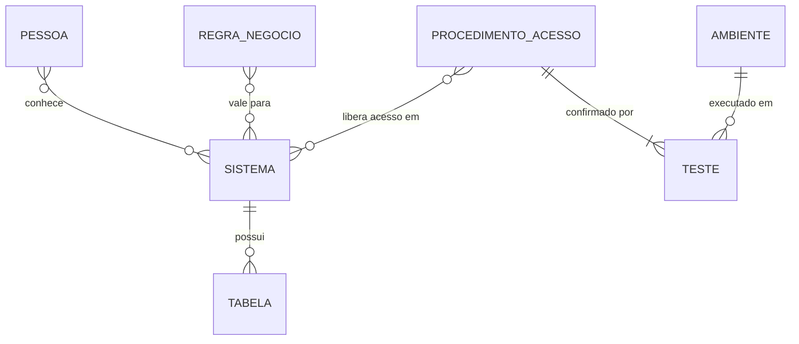

# Modelo conceitual

Entidades que o sistema precisa guardar e como elas se relacionam.

## Decisões tomadas

- Uma pessoa pode conhecer vários sistemas, e um sistema deve ter várias pessoas que o conhecem.
- Uma regra de negócio pode valer para vários sistemas.
- Cada tabela pertence a um sistema.
- Todo procedimento de acesso precisa de pelo menos um teste que confirme que funcionou.
- A estrutura da tabela é a mesma em todos os ambientes, mas cada teste é executado em um ambiente específico (produção, espelho ou testes).